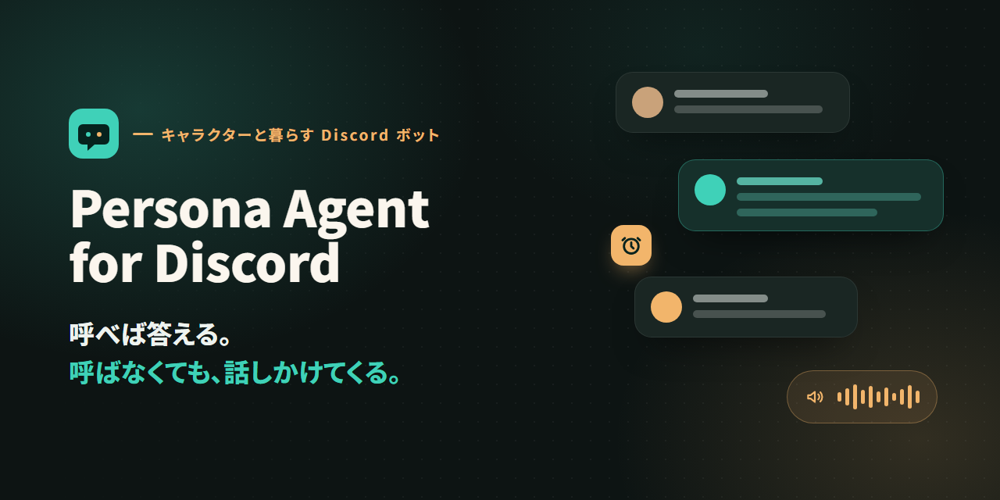

<p align="center">
  
</p>

# Persona Agent for Discord


Google Gemini を使い、あなたが作ったキャラクター（ペルソナ）になりきって会話する Discord ボットです。文字でも声でも話せて、話したことを覚えていて、ときどき自分から話しかけてきます。自分のパソコンやサーバーで動かして使います（公開の招待リンクはありません）。

> **⚠️ フィクションに関する免責事項**
>
> ペルソナはすべて**架空のキャラクター**です。性格・口調はエンターテインメント目的のロールプレイ指示であり、実在の人物・団体・属性を表現・差別・攻撃する意図は一切ありません。ボットの出力は AI による創作で、開発者の見解を反映するものではありません。
>
> `/join` の音声会話では、同意した参加者の声が Google の Gemini Live へ送られます。無料枠ではデータの扱いの条件が有料枠と異なるため、利用前に Google の利用規約（年齢の条件を含む）と Discord の規約を確認してください。

## ✨ 主な機能

- 💬 **AI チャット** — メンション（設定で全発言）にペルソナの口調で応答。画像・文書（pdf / txt / csv / md）の添付と、参考リンク付きの Google 検索にも対応
- 🎙️ **音声会話** — `/join` で呼んだボイスチャンネルで、Gemini Live と声で会話。全員の同意がそろうまで待ち、複数人の順番を管理。話している途中の割り込みとエコー除去（ver0.2.0(BETA)）
- 🧠 **長期記憶** — 会話の内容を覚えて次の会話に使う。記憶はユーザーごとに完全に分離。自分の記憶を図にして確認できる（ver0.2.0(BETA)）
- 📡 **自分から動く** — 会話が途絶えたチャンネルへ話題を振り、ボイス / ステージに自分から入って独り言とコメントへの応答を続ける（読み上げの声はペルソナごと）
- ⏰ **リマインダー・🎂 記念日のお祝い** — 会話で頼むだけで、指定した時刻（繰り返しも可）や記念日に投稿
- 🤖 **サブエージェント** — 「サブエージェントを使って」と頼むと、調べ物を別の AI に任せ、作業の経緯をスレッドに残す（完了したスレッドを閉じる: ver0.2.0(BETA)）
- 📋 **会話要約・📈 会話統計・👍 返信の評価** — 議事録の作成、本人だけに見える統計（収集の停止・削除も可）、モデル・ペルソナ別の評価の集計
- 🛡️ **モデレーション** — NG ワード（表記ゆれも検知）と AI 判定で不適切な発言を検知し、3 回でブロック。一次判定に判断専用モデル Gemini Decision 1（ver0.2.0(BETA)）
- ⚙️ **サーバーごとの設定** — ペルソナ・モデル・応答モードなどはサーバーごとに独立して保存（`/functions` の機能パネルから）

## 🔗 リンク

| | |
| --- | --- |
| 🛠️ [セットアップ](https://ri0806123789.github.io/Persona-Agent-for-Discord/setup.html) | 自分のボットとして動かすまでの手順（Python・キー・起動） |
| 🎭 [ペルソナの作り方](https://ri0806123789.github.io/Persona-Agent-for-Discord/persona.html) | キャラクターのプロンプトと、表示名・声の設定（`personas.json`） |
| 💬 [使い方](https://ri0806123789.github.io/Persona-Agent-for-Discord/usage.html) | 話しかけ方と、`/functions`・`/join`・`/leave` でできること |
| 🖥️ [運用](https://ri0806123789.github.io/Persona-Agent-for-Discord/operations.html) | 常時稼働（systemd）・更新・古い版からのデータの移行 |
| 🌐 [紹介サイト](https://ri0806123789.github.io/Persona-Agent-for-Discord/) | できることと、動作のイメージ |
| 📋 [更新履歴](docs/release-notes/README.md) | 最新: [ver0.2.0(BETA)](docs/release-notes/ver0.2.0.md) |
| 🤝 [貢献ガイド](CONTRIBUTING.md) | 開発への参加・バグ報告・機能提案（参加時のルールは[行動規範](CODE_OF_CONDUCT.md)） |
| 🔒 [セキュリティポリシー](SECURITY.md) | 脆弱性の報告の窓口 |

---

## 🧑‍💻 開発者向け

### 📁 ディレクトリ構成

主なフォルダだけを載せています（詳しい設計は [CLAUDE.md](CLAUDE.md)）。

```
Persona-Agent-for-Discord/
├── src/               # ボット本体。bot.py が起動と配線、persona_bot/ に config・core・services・views・audio・utils
├── tests/             # 回帰テスト（構成と個別実行は tests/README.md）
├── prompts/           # ペルソナ。Git の管理対象は書式見本の 2 つだけ（キャラ別のファイルは各自で作る）
├── data/              # 実行時のデータ（memory/ に SQLite の DB と記憶、ng/ に NG ワードとブラックリスト。中身は Git の管理対象外）
├── deploy/            # systemd ユニットの見本（bot.service.example）と移行用のスクリプト
├── docs/              # リリースノート（release-notes/）とフロー図
├── Site/              # 紹介サイトと説明ページ（GitHub Pages で公開。Site/README.md）
├── tools/console/     # 開発者用ダッシュボード（tools/console/README.md）
├── .github/           # CI（回帰テスト・依存の脆弱性検査・サイトの公開）と Dependabot の設定
├── requirements.txt   # 直接依存（推移依存は constraints.txt で固定）
└── .env.example       # API キーの見本（コピーして .env を作る）
```

### 🧪 ローカル検証

リポジトリのフォルダで実行します。API キー・`.env`・Discord・Gemini は要りません（外部サービスはモック、データは一時フォルダの架空のものを使い、実際の `data/` は変更しません）。

```bash
python -B -m unittest discover -s tests -v
```

- 依存関係・構文・メッセージ分割の確認と、紹介サイト・管理コンソールの確認の手順は、[貢献ガイド](CONTRIBUTING.md#完全ローカルで確認する)にあります。
- [回帰テストCI](.github/workflows/tests.yml) が Windows／Linux・Python 3.11／3.13 で確認し、[依存の脆弱性検査](.github/workflows/dependency-audit.yml)（`pip-audit`・`npm audit`）が依存の変更時と毎週確認します。[Dependabot](.github/dependabot.yml) は公開から 2 週間以上たった版への更新を毎週提案します。
- `src/` のモジュールを `bot.py` 以外の自作スクリプトから動かす場合は、`PYTHONIOENCODING=utf-8` を付けてください（Windows の既定の文字コードでは、絵文字を含むログで止まるため）。

### 🖥️ 開発者用ダッシュボード

ボットのサーバーへ SSH でつなぎ、稼働状態・負荷・ログ・DB・サーバーごとの設定を 1 つの画面で見守り、起動・停止・再起動・デプロイもできる開発者向けの画面です（`tools/console/`）。手元の PC だけで動き、ボットのコード（`src/`）は変更しません。セットアップと起動は [tools/console/README.md](tools/console/README.md) を参照してください（ボットとは依存関係を分けています）。

### 📦 依存パッケージ

| パッケージ | 用途 |
| --- | --- |
| `discord.py[voice]` | Discord API クライアント（ボイス用の `PyNaCl`・`davey` も入る。音声会話の受信の復号にも使う） |
| `google-genai` | Gemini API の非同期クライアント（音声会話の Gemini Live も同じ SDK） |
| `python-dotenv` | `.env` から API キーを読み込む（環境変数で渡すなら無くても動く） |
| `edge-tts` / `gTTS` | 読み上げの主エンジン / 失敗したときの退避先 |
| `miniaudio` | mp3 → PCM の変換（FFmpeg の代わり） |
| `httpx` | `google-genai` が共有する非同期・同期 HTTP 接続とファイル転送 |
| `matplotlib` / `numpy` | グラフの描画、読み上げ音声の音色の調整、音声会話の音声形式の変換 |
| `Pillow` | 添付画像の読み込み |
| `pypdf` | PDF 添付の検証 |
| `tzdata` | タイムゾーンの DB（OS に無い環境でも日本時間を使う） |

### 📖 参考文献

- [pyminiaudio（mp3 → PCM デコード）](https://github.com/irmen/pyminiaudio)
- [discord.py ボイス関連ドキュメント](https://discordpy.readthedocs.io/en/stable/api.html#voice-related)
- [Audio EQ Cookbook（バイクアッドフィルタ係数の公式）](https://www.w3.org/TR/audio-eq-cookbook/)

---

## 📄 ライセンス

[MIT License](LICENSE.md) で公開しています。`miniaudio`（MIT / パブリックドメイン）、Linux で使う `libopus`（BSD）、`PyNaCl` に含まれる `libsodium`（ISC）には、それぞれのライセンスが適用されます。ソースコードとプロンプトファイルは、すべて Claude Code によって生成されたものです。

> **⚠️ edge-tts の利用について**
>
> 読み上げの主エンジン `edge-tts` は、Microsoft Edge の読み上げ機能用のエンドポイントを使っており、**第三者向けに公開された API ではありません**。費用はかかりませんが、プログラムからの利用は明確には許諾されておらず、予告なく使えなくなる可能性があります（失敗したときは gTTS へ自動で切り替わります）。本プロジェクトは個人での利用を想定しています。公開サービスや商用で使う場合は、Google Cloud Text-to-Speech や Azure などの正式な API への移行を推奨します。
